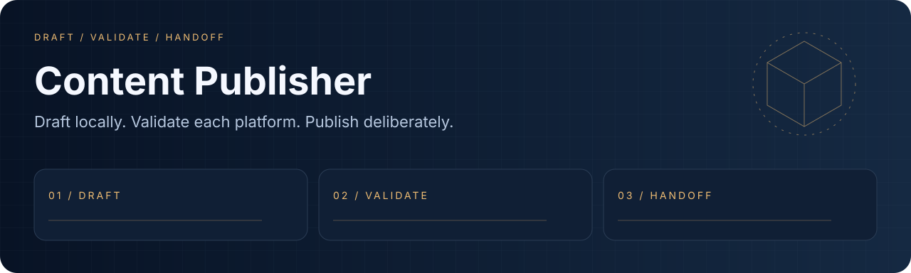
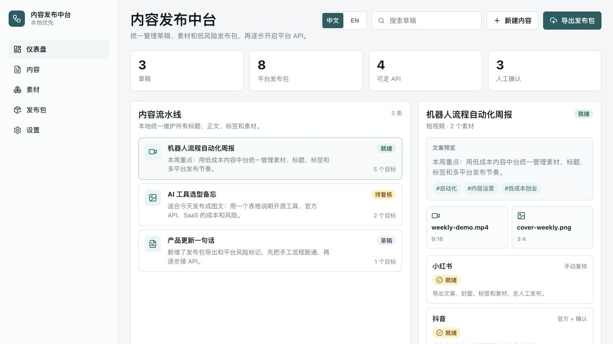

<div align="center">
  
  <h1>Content Publisher</h1>
  <p><strong>Draft locally. Validate each platform. Publish deliberately.</strong></p>
  <p><a href="LICENSE"></a> <a href="docs/readme/validation.md"></a></p>
  <p><a href="#overview">Overview</a> · <a href="#quick-start">Quick start</a> · <a href="#workflow">Workflow</a> · <a href="#validation">Validation</a> · <a href="#documentation">Docs</a></p>
  <p><a href="README.md">English</a> · <a href="README.zh-CN.md">简体中文</a></p>
</div>

---

<a id="overview"></a>
## Overview

A local content-operations dashboard with drafts, assets, platform validation, publish packages and account adapters. Start with dry runs and manual handoff.

| Capability | What it provides |
| :--- | :--- |
| **Content workspace** | Text, images and video drafts with platform-specific rules. |
| **Local accounts** | Optional localhost OAuth service, MongoDB and encrypted token storage. |
| **Explicit adapters** | Official API paths and manual-review packages have separate requirements. |

### Local demo



*Local sample drafts; no content was posted.*

<a id="quick-start"></a>
## Quick start

```bash
git clone https://github.com/eust-w/content-publisher.git
cd content-publisher
# Node.js 24 is recommended.
npm ci
npm run dev
npm run publish:dry-run -- --draft draft-001
```

<a id="workflow"></a>
## Workflow

```text
DRAFT → VALIDATE → HANDOFF
```

```bash
# Optional account service:
# Set CONTENT_PUBLISHER_MONGODB_URI and LOCAL_FRONTEND_ORIGIN in local env.
npm run auth:server
npm run accounts:list
```

<a id="validation"></a>
## Validation

```bash
npm test
npm run lint
npm run build
npm run publish:dry-run -- --draft draft-001
```

Recorded environment and executed checks: [validation notes](docs/readme/validation.md).

| Area | Current boundary |
| :--- | :--- |
| YouTube / X / Douyin | API adapters need app approval, OAuth, quotas and platform eligibility. |
| Bilibili / Xiaohongshu | Bilibili uses an approved handoff endpoint; Xiaohongshu starts with a manual package. |
| Local control plane | Health responses contain status only; browser origin must match LOCAL_FRONTEND_ORIGIN. |

On Node 26, use `NODE_OPTIONS=--no-experimental-webstorage npm test` for jsdom tests; Node 24 is recommended.

<a id="documentation"></a>
## Docs

- [Account setup / 账号配置](docs/account-testing.md)
- [Auth server / 认证服务](server/authServer.ts)
- [Platform adapters / 平台适配](src/)

## License and provenance

Original code and newly created demo assets are licensed under [Apache-2.0](LICENSE). Dependencies, models, datasets and external resources retain their terms; see [THIRD_PARTY_NOTICES.md](THIRD_PARTY_NOTICES.md).
